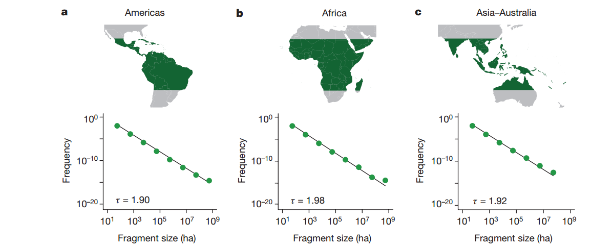
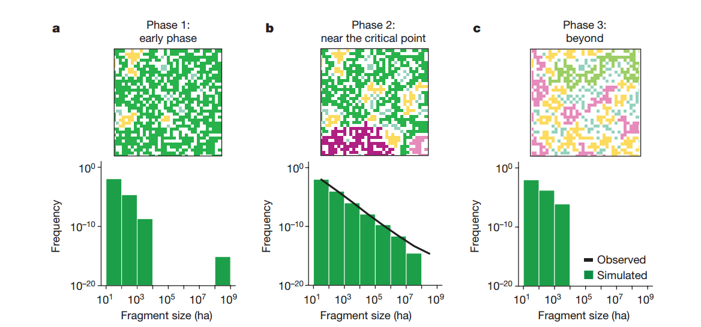
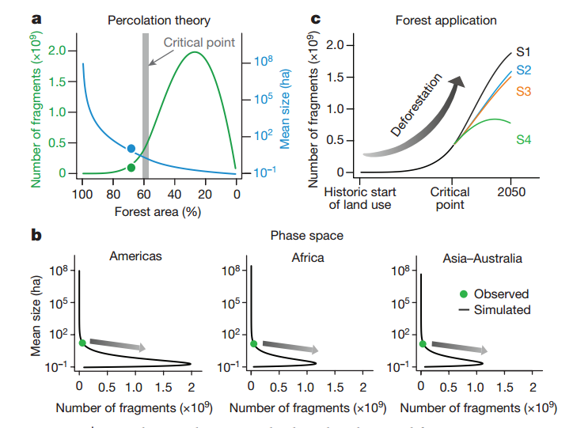

# Global patterns of tropical forest fragmentation

## Bibliographic information

- Link: [原文链接](https://www.nature.com/articles/nature25508)
- DOI: 10.1038/nature25508

## Notes

遥感技术能够在高分辨率上定量化热带森林砍伐，这种技术使得在洲际尺度热带森林破碎化研究成为可能。该研究识别了三个大洲的13亿个热带森林破碎化区域。而这些破碎化区域的大小和周长呈现类似的幂律分布特征和分形维数。渗透理论为这个格局提供了一种解释：森林的破碎化接近渗透理论的临界点。模拟结果也支持了这个结论，同时发现随机毁林或者毁林恢复的管理方式也可以塑造出这种格局。该研究以渗透理论为研究框架分析当前美洲、非洲、亚洲、澳洲热带和亚热带森林结构的破碎化。使用了高分辨率的影像（30m)和一种聚类算法识别13亿个破碎化斑块。本身预期结果是，不同大洲不同的土地利用状况可能导致森林结构破碎化的差异，但事实却是在三个大洲上都呈现了相似的幂律分布规律。
渗透理论解释：
定义森林占据景观总栅格数的概率为p。渗透理论临界点值为0.59。当p很大时，整个景观都被森林占据（a）。当p接近临界点的时候，会形成所谓的"spanning cluster",能够从景观的一侧到达另一侧,相当于廊道。而当小于临界值p的时候（c,d），森林斑块无法连通景观，将导致森林斑块会愈加破碎化。
目前的研究表明三个大洲的P值均接近于临界点。这里使用了三个动态景观破碎化模拟模型FRAG, FRAG-B, FRAG-P。
FRAG适用经典模型，而FRAG-B和FRAG-P则适用于复杂森林管理的模拟（方法见原文链接）。

情景模拟结果表明，再造林和保护大片森林（如a和b这样的）能够减缓全球森林破碎化的现状。

## Highlights

(1) 三个大洲热带森林高分辨率森林覆盖图(30 m)
(2) 全球热带森林结构破碎化格局符合幂律分布特征
(3) 渗透理论构建的研究框架
(4) 动态景观破碎化模拟模型：FRAG, FRAG-B, FRAG-P

## Research gap/question

全球热带森林结构破碎化格局、未来的变化以及对气候变化的响应。

## Discussion/Conclusion

(1) The findings of the extended percolation models underpin the universality of fragmentation patterns close to the critical point. 扩展渗透模型发现支撑了接近临界值的破碎化景观格局的普遍性。
(2) This is a general feature of critical phenomena: their large-scale behaviour is independent of the underlying small-scale mechanisms.关键现象的一般特征，大尺度的行为是独立于小尺度的机制的。
(3)Even though land use appears to be complex and diverse, our outcomes emphasize that simple mechanisms are sufficient for describing forest fragmentation structures at larger scales. 尽管土地利用变化多样复杂，我们的结果显示了简单的机制足以描述大尺度森林结构的破碎化。
景观生态理论，遥感，森林生态学与气候变化的结合，从理论到实践。

## Graph/Table interested

## Resources

[幂律分布拟合相关代码（Matlab）](http://tuvalu.santafe.edu/~aaronc/powerlaws/bins/)

