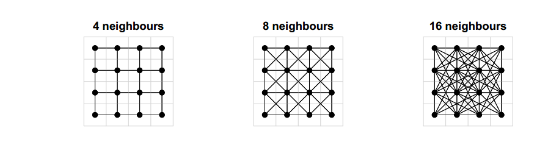
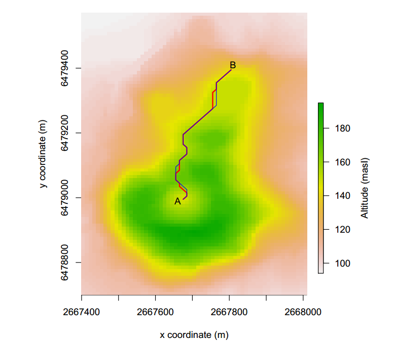

# R Package gdistance: Distances and Routes on Geographical Grids

## Bibliographic information

- Link: [原文链接](https://www.jstatsoft.org/article/view/v076i13)
- DOI: 10.18637/jss.v076.i13

## Notes

这篇文章源自统计学SCI顶刊（Journal of Statistical Software），偏向于软件开发类的文章。主要介绍的就是作者开发的R包——gdistance，对栅格数据的距离和路径计算（除了普通距离，包括像基于受限随机游走等的最小成本距离）的一个包。另外是提供一些class，基于内存稀疏格式可以存储从一个栅格到达另一个栅格的概率或成本的栅格数据。这篇文章分为12个部分。第一部分引言介绍了一些基础的概念。第二章阐述的是这个包的计算基础理论。这篇文章在基础理论部分谈到了很多不同GIS软件关于距离和计算的原理。包括四邻域、八邻域、十六邻域的问题。这里给出一个gdistance的概念——阻抗栅格也就是transition matrices,且存储的是类似于阻抗n而不是过往GIS软件里的阻抗率1/n，这一点主要是存储方便。不对称矩transition matrices的建立主要通过定义一个function，使得f(i,j)≠f(j,i)。第三部分讲的是栅格基础的内容（这个包依赖于raster）。第四部分讲的是本包根本的类transition* classes。第四部分到第八部分是gdistance求取栅格距离和最短路径计算的步骤。先创建transition* classes，接着由于投影造成的栅格失真，可以通过第五部分的校正处理。第六部分就可以计算距离了（依赖于igraph）。第七部分计算基于随机游走的离散距离。第八部分介绍的是如何确定轨迹的重叠程度。第九部分和第十部分是两个案例研究——登山路径以及遗传的地理隔绝现象。第十一部分是future study。第十二部分是联系方式等。
总的来说，这篇文章偏向于软件开发和算法，针对栅格数据的距离计算展开了一系列的研究，并开发了gdistance，两个 案例研究体现了gdistance关键函数和算法。

## Highlights

(1)  gdistance包；
(2) transition* classes；
(3) 多种应用场景的不同距离算法函数。

## Research gap/question

栅格数据的距离计算和最短路径求取的优化以及更精确表达。

## Discussion/Conclusion

(1) The section on distance transforms in de Smith, Goodchild, and Longley (2009) also discusses 16-cell neighborhoods.Connecting in 16 directions may increase the accuracy of the calculations.16邻域的邻域计算法则可能会提高距离计算的精度。
(2) More research on the consequences of connecting grids in different ways is necessary, as indicated in Section 2. This should bring more precision to random walk calculations in geospatial analysis. Comparing the results of grid-based calculations to continuous space simulations or analytical solutions would be the way forward. 不同邻域设置导致研究后果差异是值得关注的，这些会提高计算精度。

软件开发类文章讨论较少，Future Study是一个比较值得关注的点。

## Graph/Table interested

## Resources

[gdistance](https://github.com/cran/gdistance)
[circuitscape](http://www.circuitscape.org)

