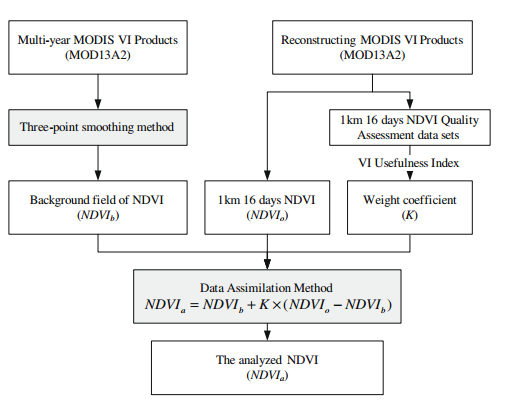
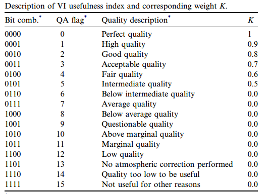
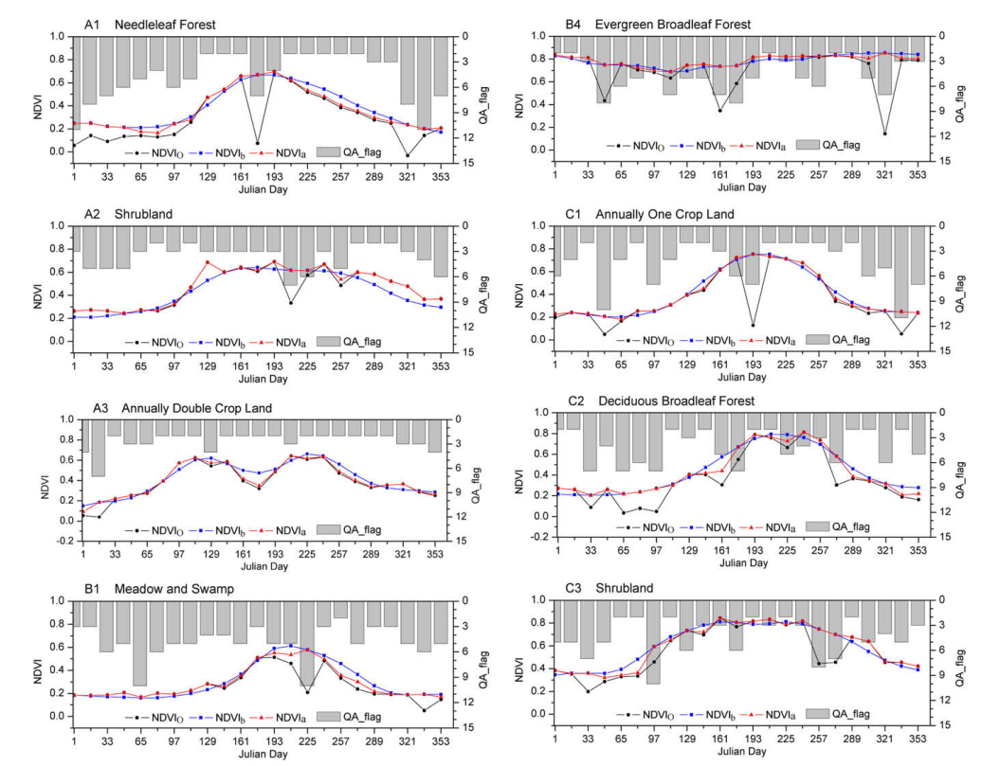

# A simplified data assimilation method for reconstructing time-series MODIS NDVI data

## Bibliographic information

- Link: [原文链接](https://www.sciencedirect.com/science/article/pii/S0273117709003512)
- DOI: 10.1016/j.asr.2009.05.009

## Notes

这个研究提供了一种简化的数据同化方法用来重建MODIS NDVI的时间序列数据。该研究使用三点平滑方法利用前三年的数据生成一个背景场数据，这个方法可以捕捉NDVI变化的年度特征，用2006年NDVI数据来测试这种简化的数据同化方法。每个时间步长，采用MODIS的QA数据根据经验确定背景场与NDVI观测值之间的权重。结果表明该方法有很好的鲁棒性和有效性。提出了数据同化通用的代价函数，并将代价函数引入到NDVI的数据同化框架时，进行了简化和推导。从而简化了数据同化的方式，同时由于难以直接估计背景场与观测场的误差协方差，于是通过MODIS的QA数据，根据经验计算权重系数。

## Highlights

(1) 一种简化的NDVI数据同化方式;
(2)基于三点平滑的方法生成背景场;
(3)在难以直接估计背景场和观测场的误差时，使用QA数据对权重系数计算。

## Research gap/question

数据同化技术过去是在气象、水文领域率先兴起的，但是同时地学下的对地观测数据、地面观测数据都存在大量噪声，如何整合这些含有噪声的数据得到更为精确的时空数据是目前地学研究的一大重点，而数据同化就是其中的一种关键性的方法。

## Discussion/Conclusion

(1)  The background NDVI field has certain limitations in capturing detailed variations, but it can offer valuable information with respect to identifying and correcting noisy points in a multi-year average profile of vegetation. NDVI背景场在捕获详细变化方面有一定的局限性，但它可以提供有价值的信息，用于识别和纠正多年平均NDVI中的噪声点。
(2)An important reason for this is the use of the synchronous QA flag to estimate the NDVI and to enable realistic corrections. However, the current reconstructing scheme can not always perform well at the onset of spring green due to the average background. The effects of outliers (e.g. strong spurious lows) will be considered as well for reducing the extension from neighboring data points. So a more effective scheme to determine the weight coefficient K will be developed.其中一个重要原因是使用QA数据来估计NDVI并校正。然而，由于背景场是多年平均得到的，目前的重建方案在春季植被变绿的开始阶段并表现不总是良好。异常值的影响（例如强烈的低估）也将被用于减少相邻数据点的扩展。因此，未来应当开发一个更有效的确定权重系数K的方案。
这篇文章对于数据同化的概念理解是非常好的，而且也提供了一个范例，将数据同化的方法引入到生态学研究中。

## Graph/Table interested

## Resources

无

