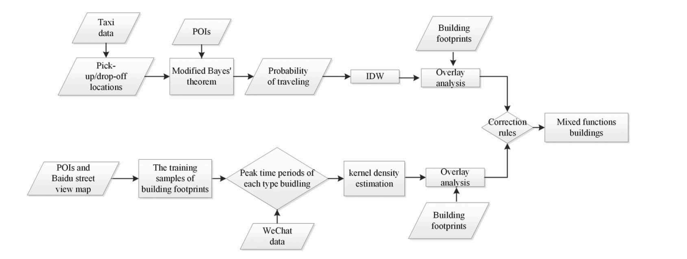
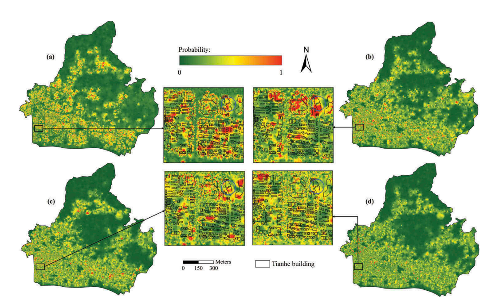
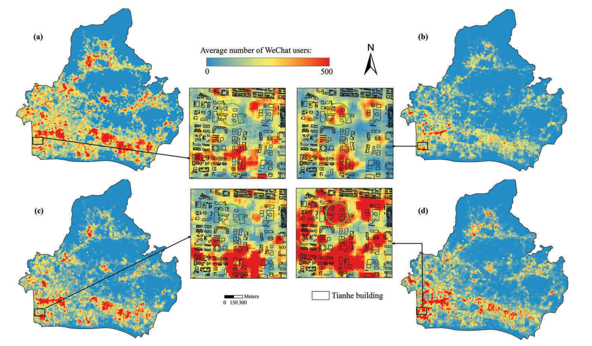
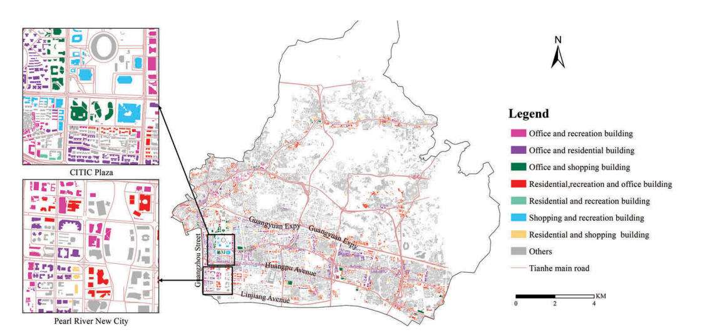
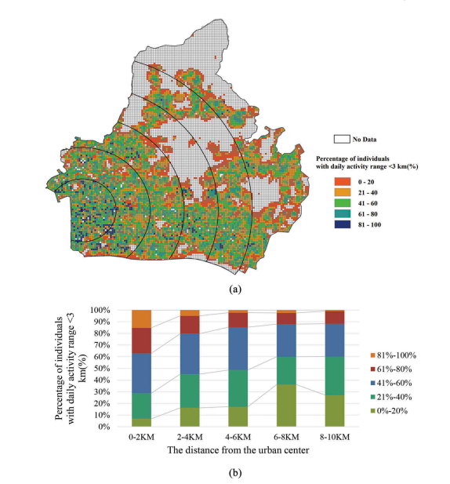

# Characterizing mixed-use buildings based on multi-source big data

## Bibliographic information

- Link: [原文链接](https://www.tandfonline.com/doi/abs/10.1080/13658816.2017.1410549)
- DOI: 10.1080/13658816.2017.1410549

## Notes

这个研究主要是集成了多源大数据（社交网络数据、出租车轨迹数据、POI兴趣点数据和遥感图像），利用一个概率模型来表征城市当中的混合功能建筑物的识别。并且以广州市天河区为例，模型分类精度达到了85%，同时对建筑物的空间分布模式进一步探究，大多数混合功能的建筑物都位于主要街道，而这个方法也将为小尺度城市规划评估和决策研究提供支持。文章主要重点是这个可以分类的概率模型。技术流程图如下：

数据源有四个社交网络数据（腾讯宜出行平台的时空数据）、出租车轨迹数据、POI兴趣点数据以及建筑足迹（Quick Bird影像解译），多源大数据共计两天时间获取（一天周末，一天工作日）。First Stage：首先出租车轨迹数据先提取了上下车的地点，接着用POI数据基于贝叶斯原理进行修正，得到不同建筑物乘客乘出租车出行目的的最大概率，当有多个出行目的的最大概率，就认为是混合功能建筑物。后期用IDW插值，最后与建筑足迹数据叠加。Second Stage：随机选取一些建筑物通过POI和百度街景地图识别出建筑物功能作为训练样本，统计建筑物内微信使用者的数量。这里有一个假设，人由于特定的目的（休息、吃饭等 ）长时间位于固定地点（家、餐厅），这些被称为活动中心，而关键假设就是，同一种功能的建筑物与微信用户的日常活动有相同的高峰时间。接着使用核密度估计方法来识别这些功能，如果有多个高峰时期就认为是混合功能建筑物。First Stage和Second Stage叠加之后，可能结果存在差异，又构建了一个correctation rule来进行推断。

## Highlights

(1) 一种集成多源大数据和概率模型表征城市混合功能建筑物识别的方法；
(2) 高精度分类模型；
(3) 混合功能建筑空间分布模式。

## Research gap/question

到目前为止很少有研究能成功整合多源大数据描述城市混合功能建筑物识别。

## Discussion/Conclusion

(1) Spatial distribution of mixed-use buildings. 混合功能区建筑物的分布与距城市中心的距离是一致的。从城市的内部到外部，建筑物的功能从混合到单一变化。
(2) Spatial interaction between human activities and buildings’ functions. 建筑物类型影响了人类活动，建筑物类型越复杂，混合程度越高，居民通勤距离就越短。
(3) Sources of inference errors. 多源数据，结构不同，采集时间也有差异。
IJGIS这篇文章的讨论部分偏向于研究结果的解释以及目前研究的不足缺陷。

## Graph/Table interested

## Resources

无

